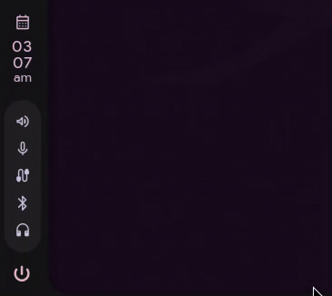

# Caelestia shell integration

Bar widget + a full Control Center window for
[caelestia-dots/shell](https://github.com/caelestia-dots/shell) (Quickshell):
a headphones icon in the status column that turns orange at ≤20% and red at
≤10%, with a bolt badge while charging and a check-circle badge once fully
charged via cable. Hovering opens a Synapse-style popout (progress ring,
percentage, "Controls" button); clicking it opens a floating window with
Lights, Equalizer, and placeholder tabs for Haptics/Microphone/THX. The
window's border and close-button notch use Caelestia's native Blob metaball
system (the same one Nexus/Settings uses), and every color pulls from
`Colours.palette.*` theme tokens, so it stays live-reactive to whatever
scheme you're running — no hardcoded hex, no restart needed on a scheme
switch.

Battery updates every 8 s (fast enough to notice a plain RF headset
power-cycle, which raises no udev event on its own), plus instantly on USB
plug/unplug via `udevadm monitor`. Whenever the headset comes back online,
`KrakenBattery.qml` auto-triggers `kraken lights restore` so the last color
you set comes back on its own — no need to reselect it after every
power-cycle. The Equalizer tab queries the real hardware state
(`kraken eq status --json`) on load, so the current preset shows as selected
immediately instead of only after you click one.



Requires `kraken` installed at `~/.local/bin/kraken` (see the main README).

## Files

- `KrakenBattery.qml` → copy to `services/` (singleton that polls
  `kraken battery --json`)
- `KrakenRGB.qml` → copy to `services/` (singleton that fire-and-forgets
  `kraken lights ...` calls, and reads `~/.cache/kraken-rgb-state` on load
  and on change so it stays in sync with the real light even if something
  outside this app changed it)
- `KrakenEQ.qml` → copy to `services/` (singleton that polls
  `kraken eq status --json` and fire-and-forgets preset changes)
- `Kraken.qml` → copy to `modules/bar/popouts/` (the hover popout — battery
  ring plus a "Controls" button that opens the window below)
- `KrakenControlWindowFactory.qml` → copy to `modules/bar/popouts/` (the
  `FloatingWindow` wrapper — fade-in on open, drop shadow)
- `KrakenControlWindow.qml` → copy to `modules/bar/popouts/` (tabs, a
  battery icon + percentage next to them, the Blob-based border/notch,
  tab-switch fade+slide animation)
- `KrakenLightsTab.qml` → copy to `modules/bar/popouts/` (presets, custom
  colour wheel, effects chips, on/off toggle)
- `KrakenEqTab.qml` → copy to `modules/bar/popouts/` (EQ preset grid)
- `KrakenWipTab.qml` → copy to `modules/bar/popouts/` ("coming soon"
  placeholder used for the Haptics/Microphone/THX tabs)

## Manual edits

### `modules/bar/components/StatusIcons.qml`

Add a loader after the existing battery icon:

```qml
// Headset battery icon (Razer Kraken V4 Pro)
WrappedLoader {
    name: "krakenbattery"
    active: KrakenBattery.available

    sourceComponent: Item {
        implicitWidth: headsetIcon.implicitWidth
        implicitHeight: headsetIcon.implicitHeight

        MaterialIcon {
            id: headsetIcon

            animate: true
            text: "headphones"
            color: {
                if (KrakenBattery.percentage <= 10)
                    return "#f44336";
                if (KrakenBattery.percentage <= 20)
                    return "#ff9800";
                return root.colour;
            }
            fill: 1
        }

        // Bolt badge while charging, check-circle once fully charged via cable
        StyledRect {
            id: krakenBadge

            readonly property bool fullyCharged: KrakenBattery.via === "cable" && KrakenBattery.percentage >= 100

            visible: KrakenBattery.charging || fullyCharged

            anchors.right: parent.right
            anchors.bottom: parent.bottom
            anchors.rightMargin: -1
            anchors.bottomMargin: -1

            implicitWidth: krakenBadgeIcon.implicitHeight
            implicitHeight: krakenBadgeIcon.implicitHeight
            radius: Tokens.rounding.full
            color: Colours.palette.m3surface

            MaterialIcon {
                id: krakenBadgeIcon

                anchors.centerIn: parent
                fontStyle: Tokens.font.icon.builders.small.scale(0.5).build()
                text: krakenBadge.fullyCharged ? "check_circle" : "bolt"
                fill: 1
                color: krakenBadge.fullyCharged ? "#4caf50" : "#ffc107"
            }
        }
    }
}
```

### `modules/bar/popouts/Content.qml`

Register the popout next to the existing `battery` one:

```qml
Popout {
    name: "krakenbattery"
    sourceComponent: Kraken {}
}
```

### `modules/Shortcuts.qml` (optional)

Adds an IPC target so the Control Center window can be opened externally
(e.g. `qs -c caelestia ipc call kraken open` from a keybind):

```qml
IpcHandler {
    function open(): void {
        KrakenControlWindowFactory.create();
    }

    target: "kraken"
}
```

### Hyprland (or your compositor's floating-window rule)

`KrakenControlWindowFactory.qml`'s `FloatingWindow` needs an explicit float
rule — without one, a tiling WM will tile it like any other window instead of
floating it as a small control panel. For Hyprland:

```
windowrule = match:title ^(Razer Kraken V4 Pro)$, float on, center on
```

Don't pin a `size` in the rule — the window already sizes itself
(`implicitWidth`/`implicitHeight`/`minimumSize` in
`KrakenControlWindowFactory.qml`), and a fixed compositor-side size silently
overrides any size tweak you make there.

Then restart the shell (`qs kill -c caelestia && qs -c caelestia -n -d`).
